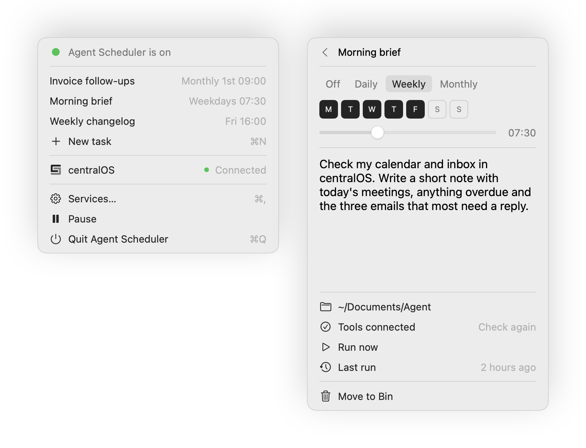
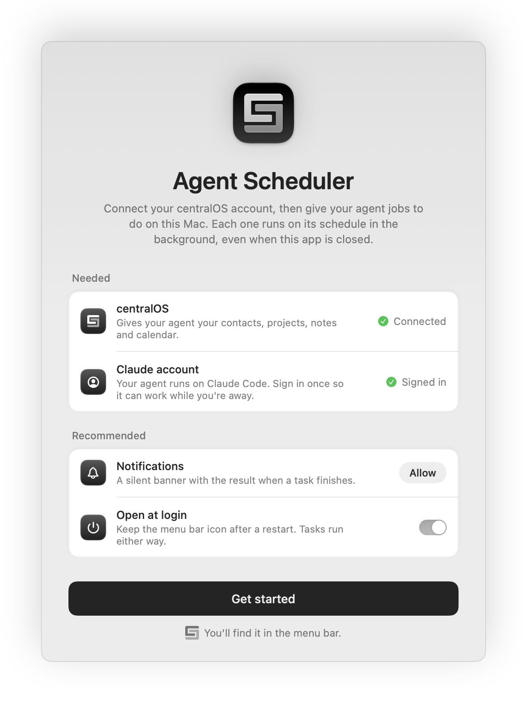

<p align="center">
  
</p>

<h1 align="center">Agent Scheduler</h1>

<p align="center">Your centralOS agent, working on your Mac on a schedule.</p>

<p align="center">
  <a href="https://github.com/Central-Software-Pty-Ltd/agent-scheduler/releases/latest"></a>
  
  
</p>

<p align="center">
  <picture>
    <source media="(prefers-color-scheme: dark)" srcset="docs/hero-dark.png">
    
  </picture>
</p>

Connect your centralOS account, then tell your agent what to do and when. Each task runs in the background, even when the app is closed.

## Requirements

- macOS 15 or later
- [Claude Code](https://claude.com/claude-code), installed and signed in
- A centralOS account

## Install

1. Download `Agent-Scheduler-<version>.zip` from the latest release.
2. Unzip it and move **Agent Scheduler** to Applications.
3. Open it. Builds are signed and notarized by Apple.

The launch page shows what to connect:

<p align="center">
  <picture>
    <source media="(prefers-color-scheme: dark)" srcset="docs/setup-dark.png">
    
  </picture>
</p>

- **centralOS** gives your agent your contacts, projects, notes and calendar.
- **Claude account** is the Claude Code sign-in your agent runs on.
- **Notifications** are optional. When a task finishes, you get a silent banner with its result.
- **Open at login** is optional and keeps the menu bar icon after a restart. Tasks run either way.

You can reopen the launch page any time from **Services…** (⌘,) in the menu.

## Using it

Click the menu bar icon to see your tasks. Choose **New task** (⌘N), then set:

- **Schedule**: Off, Daily, Weekly (pick the days) or Monthly (pick a date from the 1st to the 28th), plus a time in 15-minute steps.
- **Instructions**: what the agent should do, in plain language.
- **Folder**: where the agent works.

Changes save as you type. From a task you can also:

- **Run now** to start it straight away.
- **Last run** to open that run's session in Terminal, where you can read it and keep going.
- **Check tools** to confirm the agent's sign-ins and MCP servers are working from that folder.
- **Move to Bin** to delete the task.

The menu also shows your centralOS connection. Hover a server to re-add it, or click **Sign in** when it asks.

**Pause** stops every schedule until you choose **Resume**.

## How it works

Each task is a JSON file in `~/Library/Application Support/AgentScheduler/tasks/` with a LaunchAgent at `~/Library/LaunchAgents/au.centralsoftware.agent-scheduler.<id>.plist`. At the scheduled time, launchd runs `run.sh <id>`. The script pipes the instructions into `claude -p --permission-mode auto --output-format json` from the task's folder.

Each run writes `.json` (result and session), `.err` and `.exit` files to `runs/<id>/`. If the Mac was asleep at the scheduled time, the task runs when it wakes.

## Build from source

```sh
./scripts/make-app.sh            # build/Agent Scheduler.app
./scripts/make-app.sh --install  # install to ~/Applications and launch
./scripts/make-app.sh --zip      # build/Agent-Scheduler-<version>.zip
./scripts/make-app.sh --release  # the zip, signed with Developer ID, notarized and stapled
swift test                       # run the tests
```

`--release` needs a Developer ID Application certificate in your keychain and a notary profile, which you save once with `xcrun notarytool store-credentials agent-scheduler`. To use a different certificate or profile, set `SIGNING_IDENTITY` or `NOTARY_PROFILE`.

You need Xcode 26 or later. The app icon is an Icon Composer file, which needs that version of `actool`.

| Path | Contents |
| --- | --- |
| `Sources/AgentScheduler/Model.swift` | Value types: tasks, runs, MCP servers, health |
| `Sources/AgentScheduler/Services/` | Stateless access to the shell, the Claude CLI, task files, launchd and system settings |
| `Sources/AgentScheduler/Store.swift` | The observable state, taken from files, launchd and the CLI |
| `Sources/AgentScheduler/Views/` | The menu, the task editor, the launch page and shared components |
| `Tests/AgentSchedulerTests/` | Tests against real `claude` and `launchctl` output, and `run.sh` run end to end with a stand-in `claude` |

---

<p align="center">
  <a href="https://centralos.au">centralOS</a> ·
  <a href="https://centralsoftware.au">Central Software</a> ·
  <a href="https://docs.centralsoftware.au">Help centre</a> ·
  <a href="https://github.com/Central-Software-Pty-Ltd/agent-scheduler/releases">Releases</a> ·
  <a href="CHANGELOG.md">Changelog</a>
</p>

<p align="center"><sub>Made by <a href="https://centralsoftware.au">Central Software</a></sub></p>
